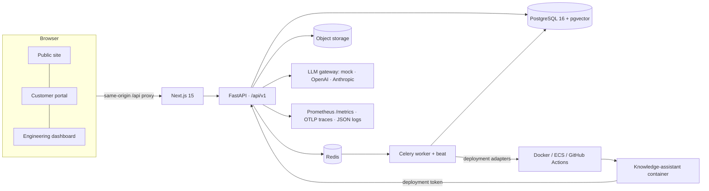

# DeployMind

**From AI prototype to production-ready enterprise systems.**

DeployMind is an end-to-end platform for enterprise AI consulting and forward-deployed engineering. It follows a
customer from first contact to an operated production system:

| Module | What it does |
| --- | --- |
| **Assess** | Public consulting site, a 29-question AI readiness assessment with **deterministic, explainable scoring**, PDF reports, and a ranked opportunity matrix with explicit ROI assumptions |
| **Build** | Multi-tenant CRM and pipeline, a discovery workspace with an AI assistant, engineer-approved requirements, AI-drafted solution architecture (Mermaid) with peer review, proposals with version history and customer approval, and Kanban project delivery |
| **Deploy** | An Enterprise Knowledge Assistant (hybrid pgvector + full-text RAG with citations and document ACLs), integrations with encrypted credentials, dev/staging/production environments, a **real local Docker deployment pipeline** with approval gates and rollback, plus GitHub Actions and AWS ECS adapters |
| **Run** | Live monitoring (P50/P95/P99, tokens, cost, uptime), an AI evaluation framework with regression alerts, incident management with customer updates, SLA-tracked support, cost management and budgets |

> The central idea: take a business problem, understand its technical and operational constraints, design a
> solution, integrate it with existing systems, deploy it, monitor it, and own the outcome.

---

## Quick start (local demo, no paid API keys)

Prerequisites: Docker, Python 3.12, Node 20, pnpm 10.

```bash
cp .env.example .env                                   # development defaults, mock AI providers
docker compose up -d postgres redis                    # pgvector Postgres :55432, Redis :56379

# Backend
cd apps/api && python3 -m venv .venv && .venv/bin/pip install -e ".[dev]"
.venv/bin/python -m app.seed.demo --reset              # migrate + seed the full demo journey
cd ../..

# Frontend
pnpm install && pnpm build:web

# Run API + worker + web (logs in var/log/)
./scripts/dev-start.sh                                 # → http://localhost:3000  ·  API docs http://localhost:8000/docs
./scripts/dev-stop.sh
```

Or use `make` targets: `make setup`, `make demo-reset`, `make start`, `make test`.

### Fully containerised

```bash
docker compose --profile app up -d --build
docker compose exec api python -m app.seed.demo --reset
```

The worker container mounts `/var/run/docker.sock` so the local Docker deployment adapter can build and run the
knowledge-assistant container.

### Demo accounts (DEVELOPMENT ONLY)

All demo accounts use the password **`DeployMind-demo-2026`**. They're created by the seed script and must never
exist in a real deployment. The API refuses to start with `APP_ENV=production` and development secrets.

| Role | Email | Lands in |
| --- | --- | --- |
| Super Admin | `admin@deploymind.example` | Dashboard |
| Organisation Admin (internal) | `ops.admin@deploymind.example` | Dashboard |
| Project Manager | `pm@deploymind.example` | Dashboard |
| Engineer | `engineer@deploymind.example` | Dashboard |
| Engineer (second reviewer) | `engineer2@deploymind.example` | Dashboard |
| Viewer (internal, read-only) | `viewer@deploymind.example` | Dashboard |
| Customer — Acme | `customer@acme-ps.example` | Customer portal |
| Organisation Admin — Acme | `it.admin@acme-ps.example` | Customer portal |
| Viewer — Acme | `auditor@acme-ps.example` | Customer portal |
| Customer — Northwind (isolation demo) | `customer@northwind-legal.example` | Customer portal |

Reset everything at any time with `make demo-reset` (or `cd apps/api && .venv/bin/python -m app.seed.demo --reset`).

See **[docs/DEMO_GUIDE.md](docs/DEMO_GUIDE.md)** for a 15-minute guided walkthrough.

---

## Architecture at a glance



* **Deterministic core, AI at the edges.** Readiness scores, opportunity ranking, cost estimates, permissions,
  state transitions and approvals are plain code. LLM agents (LangGraph) explain, draft and analyse, and every
  AI artefact is labelled a draft until a human reviews it.
* **Tenant isolation by construction.** Every query goes through `Principal.scope_filter` / `get_scoped`.
  Out-of-scope IDs return 404. Retrieval applies tenant and document ACLs inside SQL.
* **Honest telemetry.** Seeded demo traffic is stored with `source = demo_seed` and is never mixed into the default
  "real telemetry" view. Seeded deployment records are flagged `is_demo`.

Details: [ARCHITECTURE](docs/ARCHITECTURE.md) · [AI agents](docs/AI_AGENT_DESIGN.md) · [Database](docs/DATABASE.md) ·
[API](docs/API.md) · [Security](docs/SECURITY.md) · [Deployment](docs/DEPLOYMENT.md) ·
[Observability](docs/OBSERVABILITY.md) · [ADRs](docs/adr/) · [Contributing](docs/CONTRIBUTING.md)

## Repository layout

```
apps/
  api/                FastAPI app: domain, services, AI agents, RAG, deploy adapters, Celery tasks, Alembic, tests
    app/domain/       deterministic logic (question bank, scoring, opportunities, state machines, SLAs)
    app/ai/           provider abstraction, LangGraph agent framework, agents, authorised tools
    app/rag/          parsing, chunking, embeddings, hybrid retrieval, grounded assistant graph
    app/deploy/       deployment adapters (local Docker, GitHub Actions, AWS ECS)
    app/api/v1/       REST routers
    app/seed/         bootstrap reference data + demo journey + demo documents
  worker/             worker Dockerfile (Celery shares the api package)
  web/                Next.js App Router: public site, customer portal, engineering dashboard, Vitest + Playwright
  assistant-service/  the knowledge-assistant microservice delivered to customers (built and run by the deploy adapter)
packages/shared/      TypeScript domain constants shared with the web app
infrastructure/       docker (Postgres init) and Terraform (AWS ECS/Fargate reference)
.github/workflows/    CI (lint, types, tests, security, images, e2e) and Deploy (approval-gated ECS release)
docs/                 architecture, API, database, security, deployment, agents, observability, demo guide, ADRs
scripts/              dev-start.sh / dev-stop.sh
```

## Testing

| Suite | Command | Covers |
| --- | --- | --- |
| Backend (75 tests, real Postgres) | `cd apps/api && .venv/bin/pytest` | scoring, auth/refresh rotation, RBAC, **tenant isolation**, RAG and ACLs, agents, deployments, integrations, security, full journey |
| Frontend unit/component (17) | `pnpm test:web` | form validation, API client (refresh/idempotency/errors), assessment logic, components |
| End-to-end (11, Playwright) | `pnpm test:e2e` (stack running, seeded, `AUTH_RATE_LIMIT_PER_MINUTE=500`) | public site (desktop + mobile), register → assessment → report, engineer dashboards, cited answers and refusals, portal views, cross-tenant URL access |
| Lint / types | `make lint` | ruff, ESLint, `tsc --noEmit` |

The critical cross-tenant test is in `apps/api/tests/test_tenant_isolation.py`. A customer of Organisation A
calls every read and write endpoint with Organisation B's resource IDs, and every call must return 403/404 without
leaking content. Retrieval is tested the same way.

## Real vs. mock: what is honest about this demo

| Capability | Status |
| --- | --- |
| AI providers | **Mock by default** (deterministic, labelled in the UI). Set `AI_PROVIDER=openai\|anthropic` and API keys for real models; the code paths use the vendors' structured-output APIs. |
| Embeddings | Mock = feature-hashing bag-of-words (real, deterministic retrieval). `EMBEDDING_PROVIDER=openai` for semantic embeddings. |
| Local Docker deployment | **Real**: builds the image, runs its unit tests inside it, starts the container, health-checks it (blue/green), stops the old one, supports rollback. |
| GitHub Actions / AWS ECS adapters | Real API calls, but they need credentials (`GITHUB_TOKEN`, AWS). Without them the adapter reports "not configured" and never fakes success. |
| Terraform | Validates; not applied in this demo. |
| Integrations | CRM, ticketing and document-store connectors call built-in **mock services** over HTTP; the PostgreSQL connector makes a real read-only connection. |
| Telemetry | Real for every platform and deployed-container request; 14 days of seeded history is labelled "Demo telemetry". |
| Figures on the marketing site / ROI estimates | Illustrative and labelled as such. Case studies are synthetic. |

## Licence

Demonstration project. Brand, copy and code are original to DeployMind.
