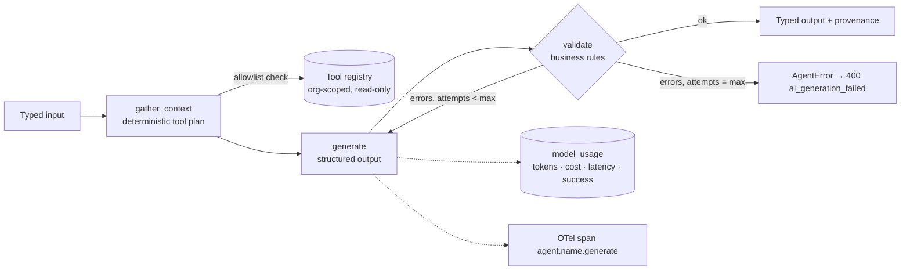
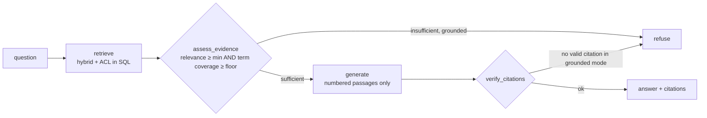

# AI agent design

## Principles

1. **LLMs reason and write; code decides.** Scores, rankings, costs, permissions, approvals and state transitions
   are deterministic services. Agents receive those results as input and may only explain them.
2. **Small, typed, bounded agents.** Each agent has a Pydantic input and output schema, an explicit tool
   allowlist, bounded retries and tracing. There are eight agents because there are eight distinct jobs.
3. **Everything AI-generated is a draft.** Requirements are created `draft`, architecture is "unvalidated until
   reviewed", proposals cannot be approved by their author when the latest version is AI-generated, and incident
   analysis is labelled advisory.
4. **Provider independence.** Application code depends on the `LLMProvider` protocol (`app/ai/providers/base.py`).
   Switching between mock, OpenAI and Anthropic is configuration, per application and per evaluation run.

## Orchestration

Implemented in `app/ai/agents/framework.py` as a compiled LangGraph `StateGraph` per agent. Tools take
`(db, org_id, ...)` and are only callable if listed in the agent's `tools`. The **tool plan is deterministic**,
which is a deliberate safety choice: the model never chooses to call a tool, so it cannot be prompt-injected
into reading another tenant's data or triggering side effects.

The Knowledge Assistant uses its own graph (`app/rag/assistant.py`):

## Agents

| Agent | Responsibility | Input → output | Tools | Validation / guardrails |
| --- | --- | --- | --- | --- |
| `assessment_agent` | Explain readiness results, adoption recommendations | scores, findings → `AssessmentNarrative` | — | rejects any "NN/100" claim that differs from computed scores; requires commentary for every dimension |
| `opportunity_research_agent` | Explain ranked opportunities, prerequisites, caveats | ranked opportunities → `OpportunityReport` | — | one narrative per opportunity; financials always "estimate" |
| `discovery_agent` | Summarise discovery, find gaps, risks, integrations; propose requirements | questionnaire, notes → `DiscoveryAnalysis` | `org_integrations`, `latest_assessment` | outputs are imported only as **draft** requirements |
| `solution_architect_agent` | Draft architecture from approved requirements | approved reqs, integrations → `ArchitectureContent` | — | ≥3 components, Mermaid must start with `graph`/`flowchart`; doc is `draft` until reviewed; edits reset review |
| `proposal_agent` | Write proposal narrative | deterministic estimate + architecture → `ProposalNarrative` | — | costs, team, milestones come from `estimate_proposal()` (rate card); agent cannot change figures |
| `knowledge_assistant_agent` | Grounded Q&A with citations | question → answer + citations | hybrid retrieval | grounded-only context, refusal token, citation verification, evidence floor |
| `evaluation_agent` | LLM-as-judge (optional) | question, expected, answer, context → `JudgeOut` | — | only with a real provider; deterministic metrics always computed too |
| `incident_analysis_agent` | Correlate telemetry and deployments | incident → `IncidentAnalysis` | `telemetry_window`, `recent_deployments` | advisory; draft customer update must be explicitly used by an engineer |

`GET /api/v1/agents` lists the registry at runtime (the Settings page renders it).

## Providers

| Provider | Chat | Structured output | Embeddings |
| --- | --- | --- | --- |
| `mock` | deterministic builders per agent (templated from inputs); extractive grounded answers for RAG | builder output validated against the schema | feature-hashing bag-of-words, 384-d, L2-normalised |
| `openai` | Chat Completions | `chat.completions.parse(response_format=Schema)` | `text-embedding-3-small` with `dimensions=384` |
| `anthropic` | Messages | forced tool call whose `input_schema` is the Pydantic JSON schema | — (use OpenAI or mock) |

Transient vendor errors (rate limits, timeouts, 5xx) are retried with exponential backoff
(`AI_MAX_RETRIES`). Failures surface as `ProviderError` → HTTP 503 `ai_provider_error` for chat, or a
`failed` report or run status for background jobs. Telemetry records the error either way.

## Cost and token tracking

Every model call writes `model_usage` (agent, provider, model, tokens, latency, success, mock flag, trace id).
Cost is computed from the `model_pricing` table (USD per million tokens, effective-dated) rather than hard-coded
prices, and can be edited under Cost Management. Unknown models cost 0 and are visible as such.

## Mock mode

`AI_PROVIDER=mock` (the default) lets the entire product run without paid keys. The UI shows a persistent "Mock AI
mode" banner, outputs carry `provenance.is_mock = true`, and the PDF report notes the mock provider. Mock outputs
are derived from the inputs. They never invent customer facts or numbers.
