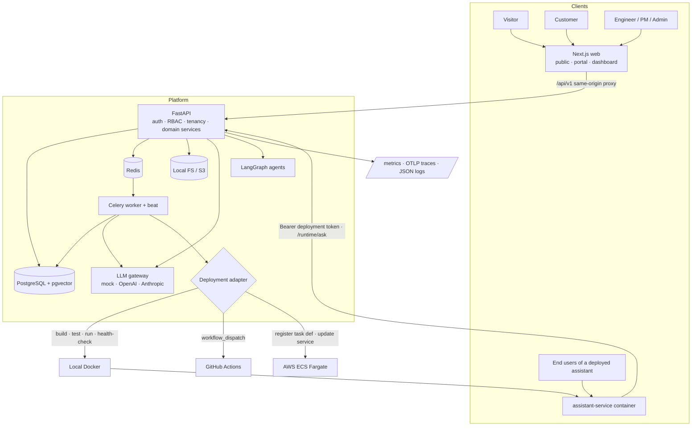
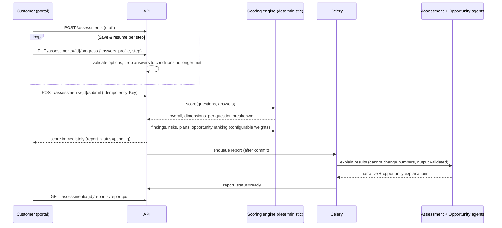
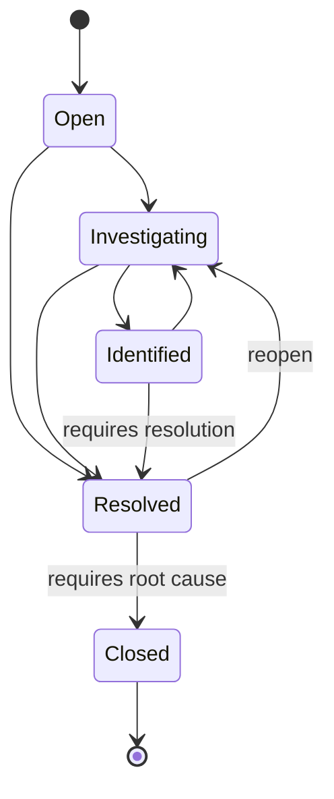

# Architecture

DeployMind is a monorepo with three runtime services, a background worker and a deliverable microservice:

| Component | Tech | Responsibility |
| --- | --- | --- |
| `apps/web` | Next.js 15 (App Router), React 19, Tailwind 4, TanStack Query, RHF + Zod, Recharts, Mermaid | Public site, customer portal (`/portal`), engineering dashboard (`/app`). Proxies `/api/v1/*` to FastAPI on the same origin. |
| `apps/api` | FastAPI, Pydantic 2, SQLAlchemy 2, Alembic | REST API, auth, RBAC, tenancy, domain services, agent orchestration, RAG |
| worker | Celery + Redis (+ beat) | Report generation, ingestion, evaluation runs, deployment pipelines, integration syncs, health checks, budget alerts |
| `apps/assistant-service` | FastAPI (tiny) | The knowledge assistant runtime delivered per environment. Calls back into the platform with a per-deployment token. |
| PostgreSQL 16 + pgvector | | System of record, vector index (HNSW), full-text index (GIN) |
| Redis | | Celery broker/results, rate-limit counters |

## System architecture



## Layering inside the API

```
app/api/v1/*        HTTP layer: request/response schemas, auth dependencies, permission checks, audit
app/services/*      application services: orchestrate domain + infrastructure inside a transaction
app/domain/*        pure deterministic logic: question bank, scoring, opportunity ranking, state machines, SLAs, cost maths
app/ai/*            provider abstraction, agent framework (LangGraph), agents, authorised tools
app/rag/*           parsing, chunking, storage, ingestion, hybrid retrieval, grounded assistant graph
app/deploy/*        deployment adapters
app/core/*          config, security, RBAC catalogue, secrets, errors, middleware, logging, tracing
app/models/*        SQLAlchemy models (UUID PKs, timestamps, TenantScoped mixin)
app/workers/*       Celery app and tasks (enqueued only after commit)
```

The domain layer has no I/O, so it is unit tested without a database (`tests/test_scoring.py`).

## Key flows

### Assessment workflow



### Discovery-to-delivery workflow

```mermaid
flowchart LR
  L[Lead<br/>New→Qualified] --> DS[Discovery session<br/>questionnaire · notes · stakeholders]
  DS --> DA[Discovery agent<br/>gaps · questions · risks · draft requirements]
  DA --> RQ{Engineer approves<br/>requirements}
  RQ -->|approved| AR[Solution architect agent<br/>draft architecture + Mermaid]
  AR --> RV{Peer review}
  RV --> PR[Proposal agent<br/>narrative around deterministic estimate]
  PR --> AP{Internal approval<br/>by a different reviewer}
  AP --> SE[Sent to customer]
  SE --> DC{Customer decision}
  DC -->|accepted| PJ[Project auto-created<br/>milestones · tasks · linked requirements]
  DC -->|rejected| PR
  PJ --> APP[AI application<br/>documents · RAG · evaluation]
  APP --> DEP[Deploy dev → staging → production]
  DEP --> RUN[Monitor · evaluate · incidents · support]
```



The lead pipeline advances automatically on real events (discovery opened, assessment submitted, proposal drafted,
proposal accepted, project handed over). Advances are forward-only and recorded in the activity timeline. Manual
changes cannot skip stages.

### Incident lifecycle



Each transition writes an `incident_updates` row. Updates flagged as customer notifications appear in the
portal timeline and generate notifications and emails.

## Cross-cutting concerns

* **Transactions.** Each request uses one session; services `flush()` and routers `commit()`. Background work is
  enqueued in SQLAlchemy `after_commit` hooks, so workers never read uncommitted rows.
* **Idempotency.** `Idempotency-Key` is honoured on assessment submission, proposal decisions and deployment
  triggers (`idempotency_keys` table; replays the stored response; rejects a reused key with a different body).
* **Errors.** All errors use the envelope `{"error": {code, message, details, request_id}}`. Unhandled
  exceptions are logged with the request id and return a generic 500.
* **Pagination / filtering / sorting.** List endpoints take `page`, `page_size` (≤100), resource filters and an
  allow-listed `sort`.
* **Live updates.** Server-Sent Events for deployment logs and the monitoring dashboard, consumed with `fetch`
  streaming so the bearer token can be sent.

## Architecture decision records

See [adr/](adr/):
[0001 monorepo and stack](adr/0001-monorepo-and-stack.md) ·
[0002 deterministic core, LLM at the edges](adr/0002-deterministic-core.md) ·
[0003 pgvector hybrid retrieval](adr/0003-pgvector-hybrid-retrieval.md) ·
[0004 tenancy model](adr/0004-tenancy-model.md) ·
[0005 deployment adapters](adr/0005-deployment-adapters.md)
