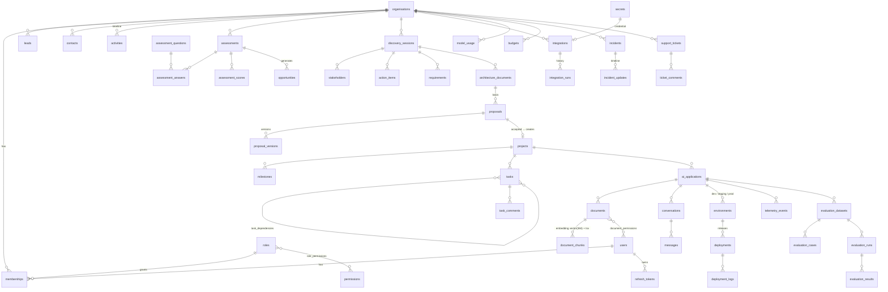

# Database

PostgreSQL 16 with the `vector` extension (pgvector). Schema managed by Alembic
(`apps/api/alembic/versions/20261030_0001_initial_schema.py`). CI checks that migrations apply, downgrade and
match the models (`alembic check`).

## Conventions

* **UUID primary keys** on every table (`UUIDPk` mixin), `created_at` / `updated_at` timestamps with time zone.
* **Tenant scoping:** tenant-owned tables use the `TenantScoped` mixin, which adds a non-null, indexed
  `organisation_id` FK with `ON DELETE CASCADE`. Every read filters on it (see [SECURITY](SECURITY.md)).
* Named constraints (`fk_*`, `uq_*`, `ix_*`) for stable migrations.
* JSONB for semi-structured, versioned payloads (assessment findings, architecture content, proposal versions,
  agent provenance). Relational columns for everything that is filtered, joined or constrained.
* Status columns are validated by deterministic state machines in `app/domain/workflow.py`.

## Entity relationships (core)



Platform-wide tables (no tenant): `users`, `roles`, `permissions`, `assessment_questions`, `model_pricing`,
`platform_settings`, `idempotency_keys`. `audit_logs` and `jobs` carry an optional `organisation_id`.

## Table inventory (57)

| Area | Tables |
| --- | --- |
| Identity & access | organisations, users, memberships, roles, permissions, role_permissions, refresh_tokens |
| Platform | audit_logs, notifications, idempotency_keys, jobs, secrets, platform_settings |
| CRM | contacts, leads, activities, discovery_calls |
| Assess | assessment_questions, assessments, assessment_answers, assessment_scores, opportunities |
| Build | discovery_sessions, stakeholders, action_items, requirements, integrations, integration_runs, architecture_documents, proposals, proposal_versions, projects, milestones, tasks, task_dependencies, task_comments |
| Knowledge | ai_applications, documents, document_permissions, document_chunks, conversations, messages |
| Deploy | environments, deployments, deployment_logs |
| Run | telemetry_events, model_usage, model_pricing, budgets, evaluation_datasets, evaluation_cases, evaluation_runs, evaluation_results, incidents, incident_updates, support_tickets, ticket_comments |

## Vector and text indexes

```sql
-- document_chunks
embedding vector(384) NOT NULL
tsv tsvector GENERATED ALWAYS AS (to_tsvector('english', content)) STORED
CREATE INDEX ix_document_chunks_embedding_hnsw ON document_chunks USING hnsw (embedding vector_cosine_ops) WITH (m = 16, ef_construction = 64);
CREATE INDEX ix_document_chunks_tsv ON document_chunks USING gin (tsv);
```

`EMBEDDING_DIMENSIONS` (default 384) is baked into the column type; changing it needs a migration and
re-ingestion.

Time-series access paths have composite indexes, `(organisation_id, created_at)` on `telemetry_events` and
`model_usage`. Monitoring percentiles use `percentile_cont` over a time-bounded subquery.

## Demo data

`python -m app.seed.demo --reset` drops the schema, re-runs migrations and seeds one complete journey for
**Acme Professional Services**. It also seeds a second tenant (Northwind Legal), staff accounts for every role,
six knowledge documents plus one restricted document, real conversations and evaluation runs, and 14 days of
telemetry labelled `demo_seed`. The seed refuses to run when `APP_ENV=production`.
