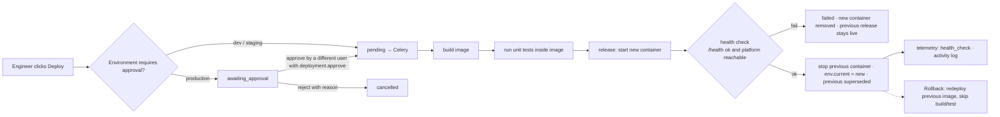

# Deployment

There are two kinds of deployment in this repository:

1. **Deploying the DeployMind platform itself** (API, worker, web) with Docker Compose locally, or on AWS with
   Terraform and GitHub Actions.
2. **Deploying customer AI applications from inside DeployMind**: the knowledge-assistant service, promoted
   through development → staging → production by the deployment pipeline and its adapters.

## 1. Running the platform

### Local (processes)
See the README quick start. `scripts/dev-start.sh` runs uvicorn, Celery (+ beat) and `next start` in their own
process groups, with logs in `var/log/`.

### Local (containers)
```bash
docker compose --profile app up -d --build          # postgres, redis, api, worker, web
docker compose exec api python -m app.seed.demo --reset
```
* `api` runs `alembic upgrade head` before starting uvicorn.
* `worker` mounts `/var/run/docker.sock` so the local Docker adapter can build and run assistant containers.
  These containers reach the API at `http://host.docker.internal:8000`.
* `web` is built with `API_INTERNAL_URL=http://api:8000`. Next.js resolves rewrites at **build** time, so it's a
  build argument.

### AWS (reference)
`infrastructure/terraform` provisions VPC, ECS Fargate services (api, web, worker, assistant) with the deployment
circuit breaker (auto-rollback), ALB with TLS 1.3, RDS PostgreSQL 16 (pgvector), ElastiCache Redis, an encrypted
S3 bucket, ECR, Secrets Manager and a GitHub OIDC deploy role. It passes `terraform validate`. It was **not
applied** as part of this demo.

## 2. The application deployment pipeline



Implemented in `app/services/deployments.py` (state, approvals, logs, token issuance) and `app/deploy/adapters.py`.
Every stage writes `deployment_logs`, streamed to the UI over SSE (`/deployments/{id}/logs/stream`).

| Adapter | Status | What it does |
| --- | --- | --- |
| `local_docker` | **Real, used in the demo** | `docker build` of `apps/assistant-service`, `python -m unittest` inside the image, run with CPU/memory limits on a free port in `LOCAL_DEPLOY_PORT_RANGE`, poll `/health`, blue/green swap |
| `github_actions` | Real API, requires `GITHUB_TOKEN` + `GITHUB_REPOSITORY` | `workflow_dispatch` of `.github/workflows/deploy.yml`, then polls the run until it completes |
| `aws_ecs` | Real boto3 calls, requires AWS credentials + `AWS_ECS_CLUSTER` + `AWS_ECR_REPOSITORY` | registers a task-definition revision with the new image and env, updates the service, waits for `services_stable` |

An adapter that isn't configured raises `AdapterNotConfigured`, and the deployment is marked `failed` with that
reason. Nothing reports success for work that didn't happen. Seeded historical deployments are labelled
`is_demo` and have no runtime.

### Configuration and secrets per environment
* **Variables** (non-secret) are edited in the UI. Sensitive-looking or reserved names are rejected.
* **Secrets** are stored encrypted (`PUT /environments/{id}/secrets`), are never returned, and are decrypted only
  when injected into the container at deploy time.
* **Resources:** CPU, memory and replicas per environment (production defaults to 1 vCPU / 1 GB / 2 replicas).
* Each release snapshots its configuration (`deployments.config_snapshot`): variables, secret *names*,
  resources and the app's model, prompt and retrieval settings.

### Runtime authentication
Each release gets a random deployment token. Only its SHA-256 hash is stored. It's injected as
`DEPLOYMENT_TOKEN` and used by the container to call `/api/v1/runtime/ask` and `/runtime/health`. When a release
is superseded, rolled back or stopped, its token stops working.

## CI/CD

`.github/workflows/ci.yml` (pull requests and main):

| Job | Checks |
| --- | --- |
| API lint | ruff, mypy (advisory) |
| API tests | Alembic upgrade + `alembic check` + downgrade; pytest with coverage against pgvector Postgres and Redis service containers |
| Web | ESLint, `tsc`, Vitest, `next build` |
| Security | pip-audit, ruff `S` (bandit rules), `pnpm audit`, gitleaks |
| Docker | builds API, worker, web and assistant images; runs the assistant's unit tests inside its image |
| E2E | seeds the demo, starts the stack, runs Playwright |

`.github/workflows/deploy.yml` (manual or triggered by the `github_actions` adapter):
build → test in image → Trivy scan → push to ECR (OIDC, no static keys) → deploy to ECS and wait for stability →
smoke test. **Approval gates:** the `deploy` job targets the GitHub Environment named after the target. Configure
required reviewers on `production` so releases pause for approval. Concurrency prevents overlapping deploys
per environment.
