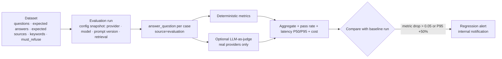

# Observability

## Signals

| Signal | Where | Notes |
| --- | --- | --- |
| Application telemetry | `telemetry_events` | one row per assistant query (latency, retrieval ms, chunks, top relevance, provider/model, tokens, estimated cost, error) and per health check |
| Model usage & cost | `model_usage` | every LLM / embedding call by every agent, with cost from `model_pricing` |
| HTTP metrics | `GET /metrics` (Prometheus) | `deploymind_http_requests_total{method,route,status}`, `deploymind_http_request_duration_seconds` histogram |
| Traces | OpenTelemetry (OTLP/HTTP) | `OTEL_ENABLED=true` instruments FastAPI; agents, tools, retrieval and generation open spans (`agent.<name>`, `tool.<name>`, `assistant.retrieve`, `assistant.generate`) |
| Logs | stdout JSON | every line has `ts`, `level`, `logger`, `msg`, `request_id`, plus structured fields (method, path, status, duration_ms, agent, tokens…) |
| Audit | `audit_logs` | security and business actions with request id |

`X-Request-ID` ties together the HTTP response, JSON logs and audit rows. Agent usage rows carry the OTel trace id.

## Real vs. demo telemetry

`telemetry_events.source` is one of:

* `platform`: requests served by the DeployMind API (portal / dashboard chat, evaluations are excluded)
* `deployment`: requests served through a deployed assistant container (`/runtime/ask`), plus health checks
* `demo_seed`: 14 days of **synthetic** history created by the seed script, including an incident spike
* `evaluation`: evaluation-run queries (excluded from monitoring by default)

The monitoring dashboard defaults to **Real telemetry** (`platform` + `deployment`). Switching to demo or all
shows a warning banner that the data is synthetic. Seeded `model_usage` rows are flagged `is_demo`, and the cost
page can include or exclude them.

## Monitoring dashboard

`GET /monitoring/overview?hours=24&source=real&app_id=…` returns:

* requests, successful, failed, error rate
* latency P50 / P95 / P99 (`percentile_cont`)
* input / output tokens, estimated cost
* retrieval: average retrieval ms, average top relevance, average chunks
* uptime from health-check events
* hourly (≤48h) or daily time series, and a per-model breakdown

`GET /monitoring/stream` pushes a fresh 1-hour overview every 5 seconds over SSE for the "Live" strip.

The worker's beat schedule probes every live environment every 5 minutes
(`deploymind.health_check_environments`), which feeds uptime.

## AI evaluation

Deterministic metrics per case (`app/services/operations.py`):

| Metric | Definition |
| --- | --- |
| correctness | expected-keyword coverage (or token F1 vs expected answer); refusal cases: 1 if the assistant refused |
| faithfulness | share of answer sentences whose content terms are ≥60% present in retrieved context |
| context relevance | mean hybrid relevance of retrieved chunks |
| retrieval precision / recall | retrieved documents vs expected sources |
| citation quality | cited documents that are expected sources |
| tool execution success | the pipeline completed without provider or tool error |
| latency, cost | per case; aggregated P50/P95 and total |

A case passes when correctness ≥ 0.5, faithfulness ≥ 0.7 and citation quality ≥ 0.5, or, for refusal cases,
when the assistant correctly refused. Runs can be compared side by side across model, prompt-version and retrieval
configurations (`/evaluations/compare`).

## Alerts

* **Evaluation regressions:** internal notification when a run regresses against its baseline.
* **Budgets:** checked every 15 minutes and on demand. One alert per threshold (e.g. 80%, 100%) per budget per
  month, sent to internal staff and the customer org.
* **Incidents** are declared by engineers (optionally after AI analysis of the telemetry window and recent
  deployments).

Wiring these notifications to PagerDuty or Slack means adding a sender next to `services/email.py`.
